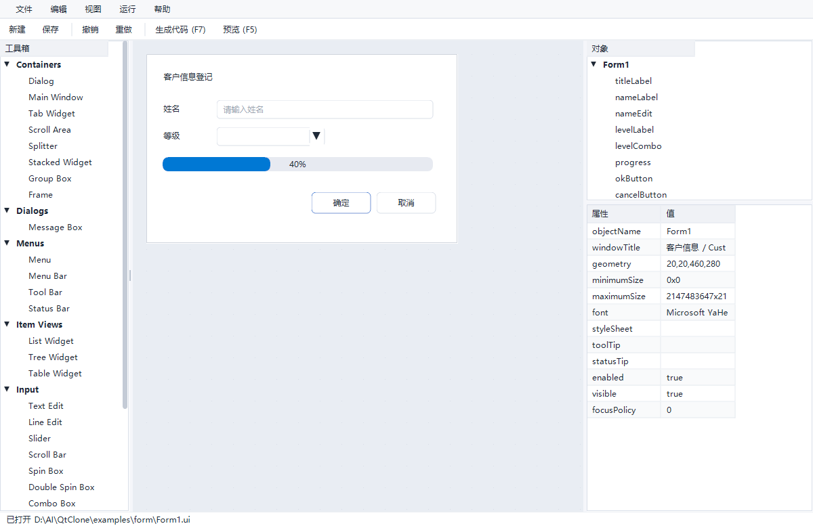
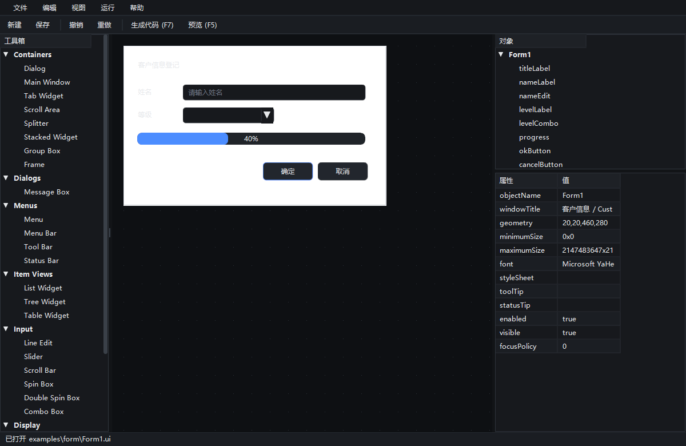
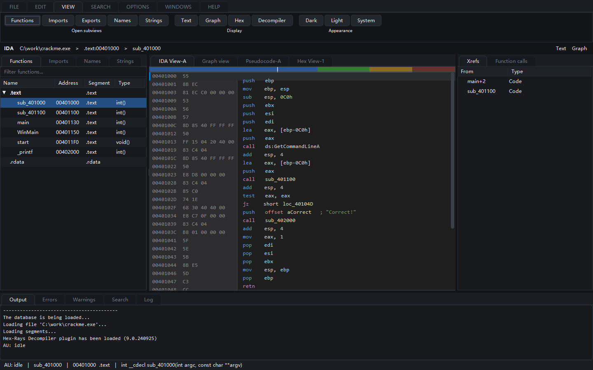
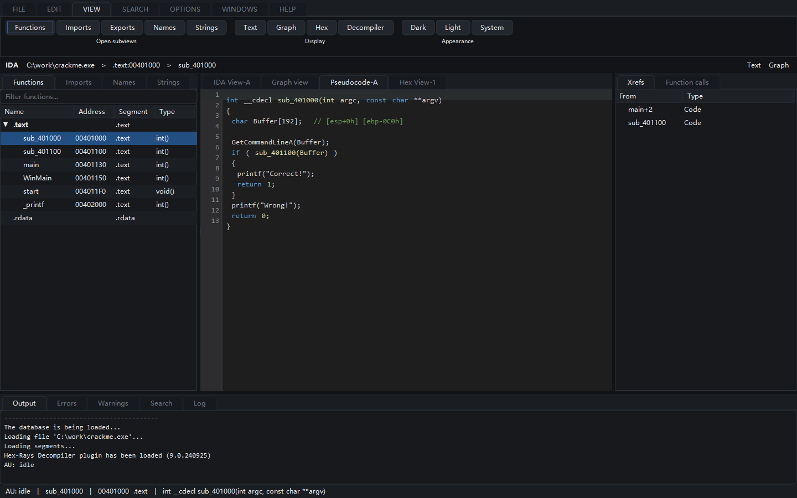
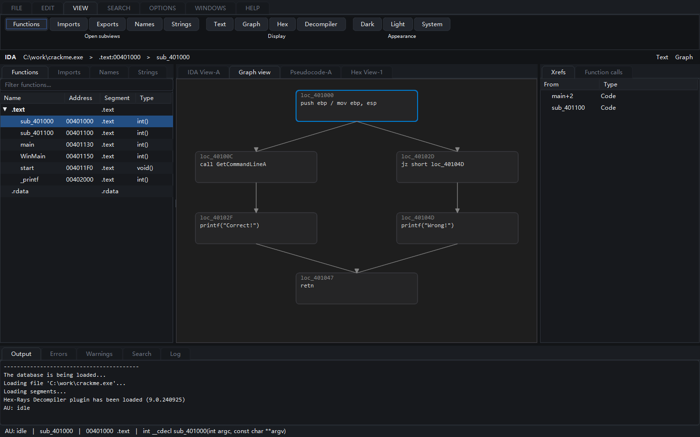
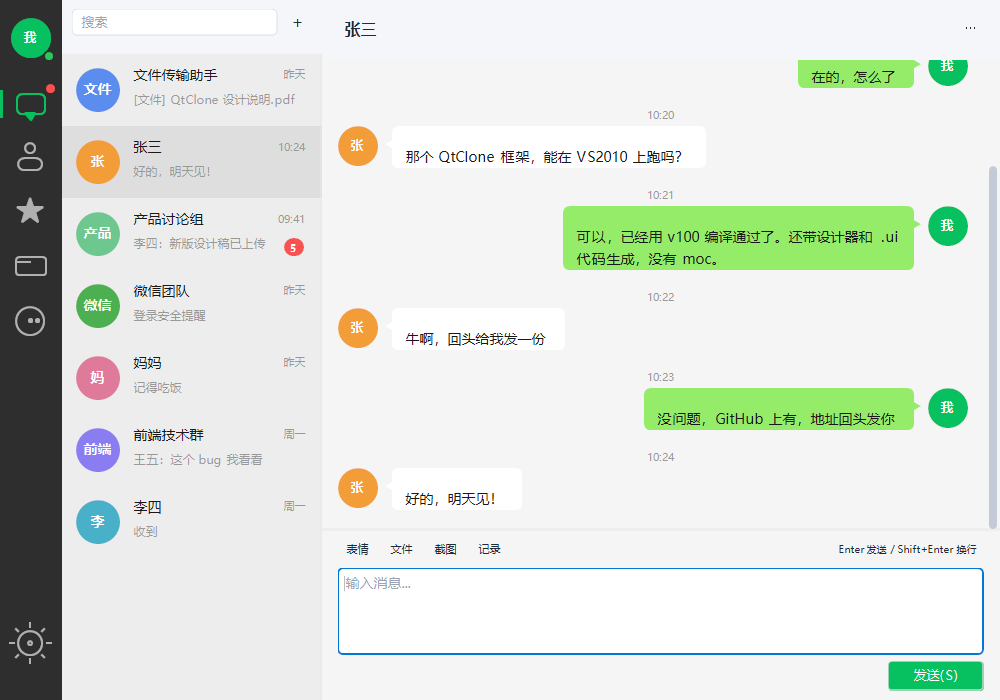
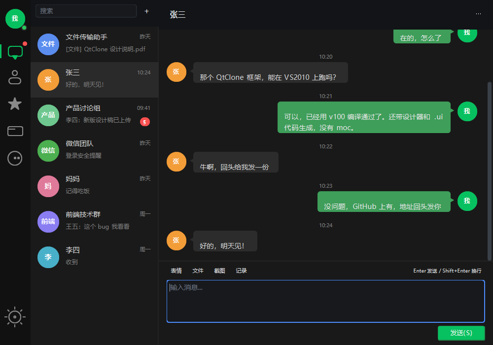

# QtClone

> **用 C++ 从零实现的 Qt 风格 GUI 框架**：QObject 元对象、信号槽、QPainter/GDI+ 绘制、
> 布局、30+ 常用控件、QSS 样式表、亮色/暗色/跟随系统主题、可视化设计器与 `.ui` 代码生成。
>
> **不需要 moc**（没有代码生成步骤），**支持 Visual Studio 2010 (v100)**，零第三方依赖，
> 只使用 Win32 + GDI+。



---

## 1. 它是什么

QtClone 是一个可实际使用的桌面 UI 开发包。它复刻的是 **Qt Widgets 的编程模型**，
而不是 QML/Quick：所有界面由 C++ 类组合而成，事件、布局、绘制、属性系统都按 Qt 的思路实现。

| 能力 | 说明 |
| --- | --- |
| 元对象系统 | 无 moc：`QTC_OBJECT` + 静态 `QMetaObject` 表，属性通过虚函数读写，支持设计器反射 |
| 信号槽 | 类型安全的 `Signal<void(int)>` 成员对象 + 成员函数指针连接，Qt 风格 `emit sig(x)` 语法 |
| 绘制 | `QPainter`（GDI+ 后端）：抗锯齿矩形/圆角/椭圆/线/多边形/文字/图片，双缓冲 |
| 控件 | QWidget/QFrame/QLabel/QPushButton/QToolButton/QCheckBox/QRadioButton/QLineEdit/QTextEdit/QComboBox/QSpinBox/QDoubleSpinBox/QSlider/QScrollBar/QProgressBar/QGroupBox/QTabWidget/QScrollArea/QSplitter/QStackedWidget/QListWidget/QTreeWidget/QTableWidget/QDialog/QMessageBox/QMenuBar/QMenu/QToolBar/QStatusBar/QMainWindow/QToolTip… |
| 布局 | `QHBoxLayout`/`QVBoxLayout`/`QGridLayout`/`QFormLayout`/`QStackedLayout`，尺寸策略、拉伸因子 |
| 样式 | QSS 子集（类型/#id/伪状态/后代选择器；背景、边框、圆角、内边距、字体、颜色、最小/最大尺寸） |
| 主题 | **亮色 / 暗色（近黑）/ 跟随系统**，运行时切换，监听 `WM_SETTINGCHANGE` 自动跟随 |
| 设计器 | 工具箱、画布（选中/拖动/8 手柄缩放/网格吸附）、属性网格、对象树、撤销/重做、F5 预览、F7 生成代码 |
| 代码生成 | `qtcuic.exe`：`.ui` → `ui_<form>.h`（`Ui_Form` + `setupUi()` + `retranslateUi()`） |
| 工程集成 | VS2010 解决方案 + `.vcxproj`，`.ui` 由 CustomBuild 步骤自动编译（无需 moc） |
| 测试 | `wf_smoke.exe`（核心/控件/布局/QSS/XML/uic）+ 设计器 `--selftest` |

已验证环境：**Windows 11 x64，Visual Studio 2010 (cl 16.00, v100)**，以及 MSBuild 4.0 全量构建；
较新的 MSVC 也可编译（`build.bat` 会自动探测）。

---

## 2. 目录结构

```
QtClone/
├─ include/qtc/           公共头文件（QtCore + QtGui + QtWidgets 风格）
│  ├─ QtGlobal.h          基础类型、Qt:: 枚举、QFlags
│  ├─ QString.h QList.h QVariant.h
│  ├─ QObject.h           QMetaObject / Signal<> / QObject / QTimer（无 moc 的核心）
│  ├─ QEvent.h QRect.h QXml.h QtGui.h QWidget.h QLayout.h QStyle.h
│  └─ QtWidgets.h         全部具体控件
├─ src/core/              字符串、变体、元对象、事件、XML
├─ src/gui/               绘制、窗口、事件循环、布局、样式、样式表
├─ src/widgets/           控件实现（基础/数值/容器/视图/对话框/菜单）
├─ designer/              QtClone Designer（可视化设计器）
├─ tools/uicgen/          .ui → C++ 生成器（设计器与 qtcuic 共用）
├─ tools/qtcuic/          uic 命令行工具
├─ examples/gallery/      控件画廊（截图源）
├─ examples/idademo/      IDA Pro 9 界面复刻（自绘反汇编/图/伪代码视图）
├─ examples/wechat/       微信 PC 版界面复刻（会话列表/气泡/输入区）
├─ examples/form/         由 Form1.ui 生成代码的完整示例（含 VS2010 自定义生成步骤）
├─ tests/smoke.cpp        冒烟测试
├─ build.bat              一键构建（库/工具/设计器/示例/测试/截图）
├─ QtClone.sln            VS2010 解决方案（qtc / qtcuic / wfdesigner / gallery / wf_form）
├─ docs/                  架构、元对象、样式、设计器、VS2010 集成文档
└─ out/                   构建产物（wf.lib、各 exe、shots/）
```

---

## 3. 快速开始

```bat
build.bat            :: 全量构建 + 冒烟测试 + 设计器自测 + 生成截图
build.bat lib        :: 只构建 out\wf.lib
build.bat clean      :: 清理 out\
```

VS2010 用户：直接打开 `QtClone.sln` 构建即可（已验证 `MSBuild.exe QtClone.sln /p:Configuration=Release`）。

产物：

| 文件 | 说明 |
| --- | --- |
| `out/wf.lib` | 静态库 |
| `out/wfdesigner.exe` | 可视化设计器 |
| `out/qtcuic.exe` | `.ui` 编译器 |
| `out/gallery.exe` | 控件画廊 |
| `out/wf_form.exe` | 由 `Form1.ui` 生成代码编译的示例 |
| `out/idademo.exe` | IDA Pro 9 风格演示程序 |
| `out/wechat.exe` | 微信 PC 风格演示程序 |
| `out/wf_smoke.exe` | 冒烟测试（控制台） |
| `out/shots/*.png` | 亮/暗主题截图 |

链接依赖：`user32 gdi32 gdiplus comctl32 comdlg32 shell32 ole32 oleaut32 shlwapi uxtheme imm32 advapi32`。

---

## 4. Hello World

```cpp
#include <qtc/QtWidgets.h>

class Window : public QWidget {
    QTC_OBJECT(Window, QWidget)
public:
    Window() {
        setWindowTitle(L"Hello");
        resize(360, 200);

        QVBoxLayout* layout = new QVBoxLayout(this);
        label_ = new QLabel(L"Hello, QtClone");
        QPushButton* button = new QPushButton(L"点我");
        layout->addWidget(label_);
        layout->addWidget(button);

        QObject::connect(button, button->clicked, this, &Window::onClicked);
    }

    QVariant qtcReadProperty(int id) const { return QWidget::qtcReadProperty(id); }
    bool qtcWriteProperty(int id, const QVariant& v) { return QWidget::qtcWriteProperty(id, v); }

private:
    void onClicked(bool) { label_->setText(L"已点击"); }
    QLabel* label_;
};

int main(int argc, char** argv) {
    QApplication app(argc, argv);
    Window window;
    window.show();
    return QApplication::exec();
}
```

要点：

* `QTC_OBJECT(Class, Base)` 取代 moc 的 `Q_OBJECT`；只需在两个虚函数里转发属性读写，
  需要**自定义属性**时在表里加一项并在 `switch` 中读写（见 `docs/reflection.md`）。
* 信号是类成员：`Signal<void(int)> valueChanged;`，发射就是调用：`valueChanged(5);`
  （`emit` 宏保留为空，兼容 Qt 写法）。
* 连接用成员函数指针，编译期检查；槽参数可以少于信号参数（自动丢弃尾部参数）。

---

## 5. 设计器



| 区域 | 功能 |
| --- | --- |
| 工具箱（左） | 按 Containers/Dialogs/Menus/Item Views/Input/Display/Buttons 分组；双击添加控件，或直接拖到画布指定位置 |
| 画布（中） | 真实控件渲染；点击选中、拖动移动、8 个手柄缩放、8px 网格吸附（Alt 临时关闭） |
| 对象树（右上） | 控件层级，点击定位 |
| 属性网格（右下） | 双击编辑：布尔直接切换，枚举下拉，颜色/字体弹系统对话框，数值/文本/几何用输入框 |
| 菜单 | 文件（新建/打开/保存/另存/生成代码/退出）、编辑（撤销/重做/删除/复制）、视图（网格/主题）、运行（F5 预览） |

快捷键：`Ctrl+N/O/S`、`Ctrl+Z/Y`、`Ctrl+D`、`Delete`、方向键微调（Shift = 8px）、`F5` 预览、`F7` 生成代码。

`.ui` 采用 Qt Designer 的 XML 结构（`<ui><class/><widget><property/>…`），
`qtcuic` 生成 `ui_<form>.h`；VS2010 工程里 `.ui` 通过 CustomBuild 步骤自动生成：

```xml
<CustomBuild Include="examples\form\Form1.ui">
  <Command>qtcuic.exe "%(FullPath)" -o "$(IntDir)ui_form1.h" -q</Command>
  <Outputs>$(IntDir)ui_form1.h</Outputs>
</CustomBuild>
```

---

## 6. 示例：复刻 IDA Pro 9 界面

`examples/idademo/` 用框架完整复刻了一个 IDA Pro 9 风格的分析界面（功能区、函数列表、
反汇编视图、控制流图、伪代码、交叉引用、输出窗口、状态栏），并支持亮/暗主题：



它完全由框架控件 + 自绘 QPainter 实现，没有 moc、没有第三方依赖：

* **功能区**：`QTabWidget` + 扁平按钮，FILE/EDIT/VIEW/SEARCH/OPTIONS/WINDOWS/HELP 七页；
* **自绘反汇编列表**：地址/机器码/助记符分列，助记符、寄存器、数字、字符串、注释分别着色，
  当前行高亮、滚轮/键盘导航，点击 `call` 跳转被调函数；
* **自绘伪代码**：行号栏 + 关键字/字符串着色；
* **自绘控制流图**：基本块、箭头连线、当前块高亮、点击联动；
* **导航带**：按段着色并可点击定位；
* **亮/暗主题**：功能区的 Dark/Light/System 按钮即时切换（同一套自绘代码，颜色随主题变化）。




运行：

```bat
out\idademo.exe                     :: 暗色，反汇编视图
out\idademo.exe --theme light
out\idademo.exe --tab graph         :: 也可 pseudo / hex
out\idademo.exe --selftest
```

详见 [docs/idademo.md](docs/idademo.md)。

## 7. 示例：复刻微信 PC 版界面

`examples/wechat/` 复刻了微信 PC 端的会话界面：左侧功能栏、会话列表、聊天气泡、
输入区与亮/暗主题，全部由框架控件 + 自绘 QPainter 实现。




* **左侧功能栏**：自绘头像与聊天/通讯录/收藏/文件/朋友圈/设置图标、未读红点、选中绿条；
* **会话列表**：头像、昵称、消息预览、时间、未读角标、选中/悬浮态、滚轮滚动；
* **聊天气泡**：自己（微信绿）/对方（白/深灰），圆角 + 小尾巴、头像、时间戳、
  群聊发送者名、自动换行、滚到底部；
* **输入区**：Enter 发送 / Shift+Enter 换行，工具栏与绿色发送按钮；
* **搜索过滤**：输入即筛选会话；
* **主题**：同一套自绘代码在亮色/暗色下自动换色。

运行：

```bat
out\wechat.exe                    :: 亮色
out\wechat.exe --theme dark
out\wechat.exe --chat 2
out\wechat.exe --selftest         :: 含真实鼠标点击的输入链路自检
```

详见 [docs/wechat.md](docs/wechat.md)。

## 8. 主题与样式表

```cpp
QTheme::setMode(QTheme::Light);   // 亮色
QTheme::setMode(QTheme::Dark);    // 暗色（近黑：#121417 / #17... ）
QTheme::setMode(QTheme::System);  // 跟随系统（读取注册表 AppsUseLightTheme，并监听变化）
```

QSS 子集：

```cpp
button->setStyleSheet(
    L"QPushButton { background-color: #0078D4; color: white; border-radius: 6px; padding: 4px 12px; }"
    L"QPushButton:hover { background-color: #106EBE; }"
    L"QPushButton:disabled { background-color: #D8DEE8; color: #9AA3AF; }");
```

支持：类型选择器、`#objectName`、伪状态 `:hover/:pressed/:checked/:disabled/:focus`、
后代选择器（空格）、逗号分隔多选择器；属性：`background(-color)`、`color`、`border*`、
`border-radius`、`padding*`、`font-family/size/weight/style`、`min/max-width/height`、
`selection-background-color`、`selection-color`。详见 `docs/styling.md`。

---

## 9. 与 Qt 的对应关系

| Qt | QtClone |
| --- | --- |
| `Q_OBJECT` + moc | `QTC_OBJECT(Class, Base)`（无生成步骤） |
| `signals: void clicked(bool);` | `Signal<void(bool)> clicked;` |
| `connect(a, SIGNAL(x()), b, SLOT(y()))` | `QObject::connect(a, a->x, b, &B::y)` |
| `Q_PROPERTY(... READ/WRITE)` | 静态属性表 + `qtcReadProperty/qtcWriteProperty` |
| `uic` | `qtcuic.exe`（生成 `Ui_Form`） |
| `QWidget` alien widget + 单 HWND | 同左：每个顶层窗口一个 HWND，子控件由父窗口统一绘制 |
| `QPainter` | 同左（GDI+ 后端，`QPixmap`/`QImage` 为 PARGB 位图） |

**没有实现**：QML/Quick、OpenGL/图形视图框架、模型/视图完整 MVC（列表/树/表为 item-based 简化模型）、
无障碍 UIA、多线程 GUI、打印支持。设计器目前只支持绝对布局（不做布局容器编辑）。
这些限制在 `docs/architecture.md` 末尾有详细说明。

---

## 10. 测试

```bat
out\wf_smoke.exe            :: 40+ 项断言：字符串/变体/XML/工厂/布局/QSS/主题/uic
out\wfdesigner.exe --selftest  :: 设计器：添加控件、序列化、撤销/重做、代码生成
```

`build.bat` 会在构建后自动运行两者，任一失败则构建失败。

---

## 11. 许可

MIT。示例、库与工具均可自由用于商业项目。`Microsoft YaHei UI` 等仅为系统字体引用。
