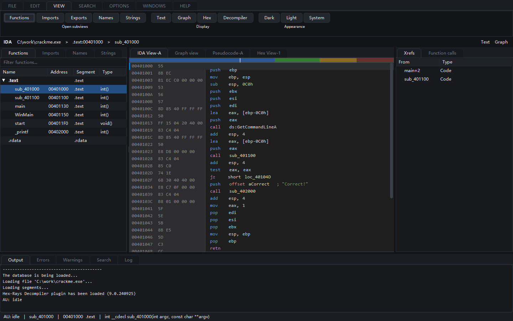

# 示例：复刻 IDA Pro 9 界面

`examples/idademo/ida_demo.cpp` 用 QtClone 复刻了一个 **IDA Pro 9 风格**的分析界面。
它是纯 UI 演示（没有反汇编引擎）：数据是内置的 `crackme.exe` 样例（函数、反汇编行、
伪代码、交叉引用、字符串），目的是展示框架在真实工具类应用中的表现。



---

## 1. 界面构成

| 区域 | 实现 |
| --- | --- |
| 顶部功能区 | `QTabWidget` + 扁平 `QPushButton`；FILE / EDIT / VIEW / SEARCH / OPTIONS / WINDOWS / HELP 七个页，按钮按组排列并带组标题（Open subviews / Display / Appearance…） |
| 面包屑/路径栏 | `QLabel`（`C:\work\crackme.exe > .text:00401000 > sub_401000`） |
| 左侧子视图 | `QTabWidget`：Functions（带过滤框与四列表格树）、Imports、Names、Strings |
| 中央视图 | `QTabWidget`：IDA View-A（自绘反汇编列表）、Graph view（自绘控制流图）、Pseudocode-A（自绘 C 伪代码）、Hex View-1 |
| 导航带 | 自绘 `NavigationBand`：按段着色（.text/.rdata/.data/.idata）+ 当前位置游标，可点击定位 |
| 右侧 | Xrefs（交叉引用）与 Function calls 两个 `QTreeWidget` |
| 底部输出窗口 | `QTabWidget`：Output / Errors / Warnings / Search / Log |
| 状态栏 | `QStatusBar`：`AU: idle | 函数 | 地址 段 | 原型` |

自绘控件（约 600 行）直接演示了框架能力：

* **反汇编列表**：地址 / 机器码 / 助记符分列；助记符、寄存器、数字、字符串、注释、跳转目标分别着色；
  当前行高亮 + 左侧强调条；滚轮滚动、方向键/PageUp/PageDown/Home/End、鼠标点击选择；
  点击 `call sub_xxx` 会跳转到对应函数（演示“导航”）。
* **伪代码视图**：行号栏、关键字/字符串/数字/函数名着色、当前行高亮、滚动。
* **控制流图**：圆角基本块、贝塞尔直角连线 + 箭头、当前块高亮、点击块联动列表。
* **导航带**：段色条 + 游标。

---

## 2. 运行

```bat
build.bat                      :: 构建 out\idademo.exe 并生成 4 张截图
out\idademo.exe                :: 正常启动（默认暗色）
out\idademo.exe --theme light
out\idademo.exe --tab graph    :: 启动时切到图形视图（pseudo / hex 同理）
out\idademo.exe --selftest     :: 无界面自检（CI 用）
out\idademo.exe --screenshot shot.png [--theme ...] [--tab ...]
```

VS2010：`QtClone.sln` 中的 `idademo` 项目（`PlatformToolset=v100`）。

---

## 3. 交互

* 左侧函数列表点击 → 反汇编、伪代码、图形、反汇编交叉引用、地址栏、状态栏同步更新。
* 点击反汇编里的 `call` → 跳到被调函数（与 IDA 的导航行为一致）。
* 顶部功能区：`Text` / `Graph` / `Hex` / `Decompiler` 切换中央视图；
  `Dark` / `Light` / `System` 即时切换主题；`About` 弹出关于框。
* 过滤框按名称过滤函数列表（大小写不敏感）。
* 导航带点击 → 状态栏显示跳转位置。

---

## 4. 截图

| 视图 | 图片 |
| --- | --- |
| 反汇编（暗色） | `docs/images/ida_dark.png` |
| 反汇编（亮色） | `docs/images/ida_light.png` |
| 伪代码 | `docs/images/ida_pseudo.png` |
| 控制流图 | `docs/images/ida_graph.png` |

---

## 5. 说明与限制

* **这是 UI 复刻，不是反汇编器**；地址、指令、伪代码均为内置演示数据。
* 没有实现可停靠面板（QtClone 无 `QDockWidget`），布局用 `QSplitter` 固定为
  左 / 中 / 右 / 下四区，符合 IDA 默认布局。
* 图形视图是简化 CFG（固定六个块），无缩放/拖动/布局算法；列表无语法高亮的完整词法分析。
* 表格列宽由框架统一切分（首列约 38%，其余均分）；IDA 的“可拖动列宽”未实现。
* 图标全部用文字代替（框架未内置图标资源），以便零外部依赖。
