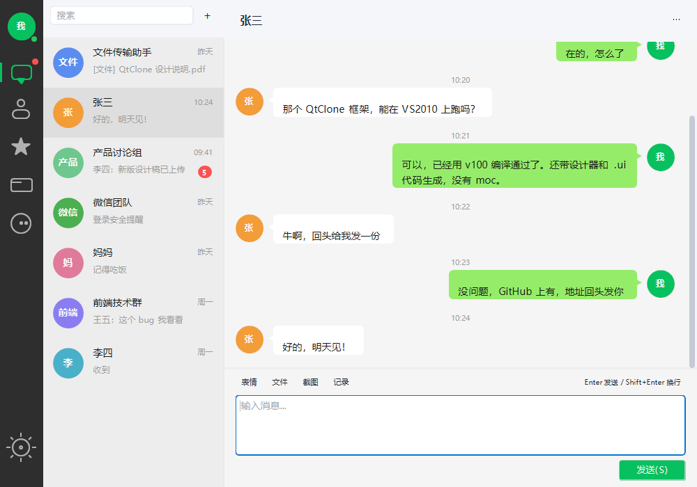
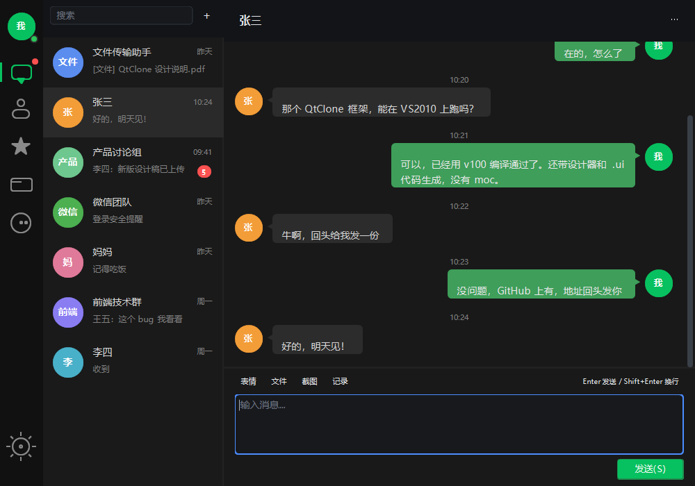

# 示例：复刻微信 PC 版界面

`examples/wechat/wechat_demo.cpp` 用 QtClone 复刻了微信 PC 端的会话界面：
左侧功能栏、会话列表、聊天气泡、输入区、搜索过滤与亮/暗主题。
它是纯 UI 演示（无网络、无账号），数据为内置的示例会话。



---

## 1. 界面构成

| 区域 | 实现 |
| --- | --- |
| 左侧功能栏 | 自绘 `WeChatSidebar`：用户头像、聊天/通讯录/收藏/文件/朋友圈/设置图标（QPainter 绘制）、未读红点、选中态绿色 |
| 会话列表 | 自绘 `ChatListWidget`：头像、昵称、最后一条消息、时间、未读红点、选中/悬浮态、滚轮滚动 |
| 搜索 | `QLineEdit` 实时过滤会话（大小写不敏感） |
| 聊天头部 | 昵称 + 群成员数 + 更多按钮 |
| 消息区 | 自绘 `MessageView`：自己/对方气泡、圆角+小尾巴、头像、时间戳、群聊发送者名、自动换行、滚动、自动滚到底部 |
| 输入区 | `QTextEdit` 子类 `InputEdit`：Enter 发送、Shift+Enter 换行；工具栏（表情/文件/截图/记录）、发送按钮 |
| 主题 | 亮色（白底 + 微信绿气泡）/ 暗色（#191919 + 深灰气泡），颜色随 `QTheme` 切换 |



---

## 2. 运行

```bat
out\wechat.exe                       :: 亮色，默认会话
out\wechat.exe --theme dark          :: 暗色
out\wechat.exe --chat 2              :: 打开第三个会话（产品讨论组）
out\wechat.exe --selftest            :: 无界面自检（含真实鼠标点击测试）
out\wechat.exe --screenshot shot.png [--theme ...] [--chat N]
```

VS2010：`QtClone.sln` 中的 `wechat` 项目（`PlatformToolset=v100`）。

---

## 3. 交互

* 点击会话列表切换会话（会清零未读角标、更新消息区与标题）。
* 输入框输入后按 Enter（或点“发送(S)”）发送消息，气泡出现在右侧、列表预览/时间同步更新。
* 搜索框输入即过滤会话列表。
* 左侧功能栏可点击切换选中态（其他入口显示演示提示）。
* 支持滚轮浏览消息与会话列表；窗口缩放时消息自动重排。

---

## 4. 自检覆盖

`--selftest` 会：

1. 校验会话/消息数据完整；
2. 向窗口发送真实的 `WM_LBUTTONDOWN/UP`（点击第三个会话），校验选中项切换 ——
   这条用例专门覆盖窗口消息 → 命中测试 → 事件分发整条链路；
3. 输入文本并发送，校验消息追加、`mine` 标记、输入框清空；
4. 过滤搜索、主题切换的往返校验。

---

## 5. 说明与限制

* **UI 复刻**：没有网络层、登录、数据库、文件传输；会话和消息是内置演示数据。
* 消息区未实现富文本/图片消息（图片消息以占位类型保留）、表情面板、拖拽文件、@ 提醒。
* 左侧功能栏只有会话页可用，通讯录/收藏/朋友圈等仅演示选中态。
* 输入框使用框架默认的焦点边框（未做微信式细边框），悬停态按钮由框架 QSS 绘制。
* 头像用“彩色圆 + 文字首字”生成，未内置图片资源，保持零外部依赖。
